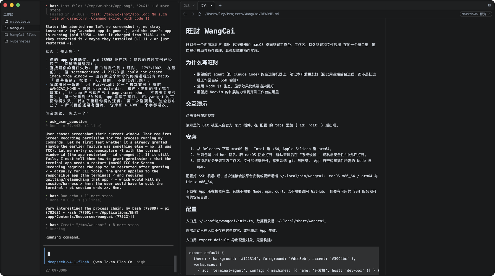
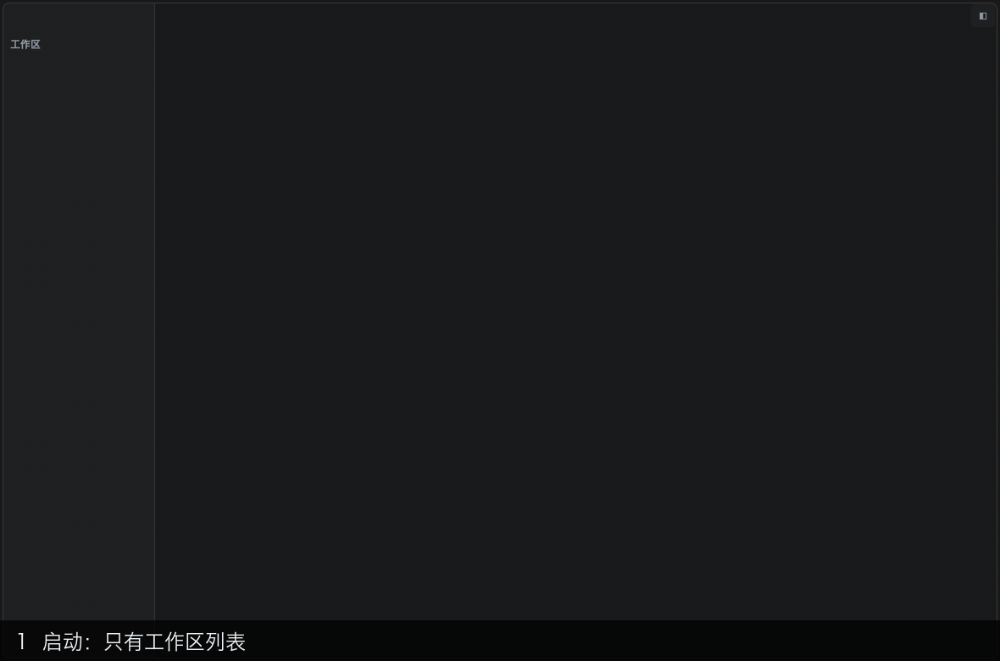

<p align="center"></p>

# 旺财 WangCai

旺财是一个面向本地与 SSH 远程机器的 macOS 桌面终端工作台：工作区、持久终端和文件视图
在同一个窗口里，窗口提供布局与插件管理，具体功能由插件实现。

App 只是壳：窗口、preload 桥与打包，另外读 `init.ts` 把插件装好，再确认 Core 是否已经装好。业务逻辑在
[WangCai-Core](https://github.com/lengmoXXL/WangCai-Core) 里，本仓库不再带它：启动时数据目录里没有构建好的
Core 就 clone 一份并用自带的 Node 构建（`~/.local/share/wangcai/core-src` 与 `core`），已经有了就直接用，
插件页里 Core 那一行的「更新」才去重新拉取。

<p align="center"></p>

## 为什么写旺财

- 期望编码 agent（如 Claude Code）跑在远端机器上，笔记本开发更友好（因此用远端后台进程，而不是把远程工作区当成 SSH 会话）
- 复用 Node.js 生态，显示效果比终端渲染更好
- 期望把 Neovim 的扩展能力带到开发工作台应用里

## 交互演示

[](docs/assets/demo.webm)

演示里的 Git 视图来自官方 `git` 插件，在 [配置](#配置) 的 `tabs` 里加 `{ id: 'git' }` 后出现。

## 安装

1. 从 [Releases](https://github.com/lengmoXXL/WangCai/releases) 下载 macOS 包：
   Intel 选 `x64`，Apple Silicon 选 `arm64`。
2. 当前包是 ad-hoc 签名；若 macOS 阻止打开，确认来源后在
   “系统设置 → 隐私与安全性”中允许打开。
3. 首次启动会先 clone 并构建业务内核 Core（见上，需要系统 `git` 与网络），再安装官方工作区、文件
   和终端插件；App 自带构建它们所需的 Node 与 npm。之后的启动用已经装好的那份，不再联网。

## 配置

入口是 `~/.config/wangcai/init.ts`，数据目录是 `~/.local/share/wangcai`。

首次启动只在入口不存在时生成它，改完重启 App 生效。

入口用 `export default` 导出配置对象，无需构建：

```ts
export default {
  theme: {
    background: '#121314',
    foreground: '#dce3eb',
    accent: '#3994bc',
  },
  workspaces: [
    {
      id: 'terminal-agent',
      config: {
        machines: [
          { host: 'local', env: { PATH: '$HOME/.local/bin:$PATH', GOPATH: '$HOME/go' } },
          { name: '开发机', host: 'dev-box', env: { PATH: '$HOME/.local/bin:$PATH' } },
          { name: '测试机', host: 'test-box' },
        ],
      },
    },
  ],
  tabs: [
    { id: 'files' },
    { id: 'terminal' },
  ],
};
```

顶层有 `theme`、`network`、`workspaces`、`tabs`；省略 `network` 表示直连，省略后两者表示列表为空，不会补回官方插件。

### 插件配置

工作区条目提供工作区列表与创建菜单，标签页条目提供侧栏视图，两者条目格式相同：

| 条目参数 | 说明 |
| --- | --- |
| `id` | 必填；插件标识，默认也用作插件目录名 |
| `repo` | Git 仓库 URL；省略来源时用官方 `WangCai-<id>` 仓库；`https://github.com/` 开头的链接按「出网（network）」出去 |
| `commit` | 交给 Git checkout 的提交或引用，推荐完整 commit SHA |
| `directory` | 插件目录；相对路径从 init.ts 所在目录解析 |
| `config` | 插件自己的配置 |

- 只填 `directory`：加载该目录的现成产物，不装依赖也不构建。
- 同时填 `repo`、`directory`：把仓库安装到指定目录。
- 默认安装到 `~/.local/share/wangcai/plugins/<id>`。
- 未固定 `commit` 时，启动复用已有构建，点击插件更新才拉取默认分支；
  固定提交时按指定引用 checkout，分支名不是“始终跟随远端”的承诺。
- 同一 `id` 重复出现时先出现的生效（先读 `workspaces` 再读 `tabs`）；
  已安装的 `id` 不能换成另一个仓库。

### 主题参数

`theme` 覆盖部分配色，值写 `'#rrggbb'`：`background`、`foreground`、`cursor`、
`selection`、`surface`、`overlay`、`border`、`muted`、`accent`，
以及 `black` 到 `brightWhite` 的 ANSI 调色板。

### 出网（network）

```ts
network: {
  proxy: 'socks5://127.0.0.1:7890',
  mirror: 'https://ghfast.top/',
},
```

`proxy` 由壳读出来：壳自己的 git 与 npm（插件 `clone`、`npm install`、重建 Core）走它；Core 的请求（下载
agent 等）走壳的 session，代理在 Core 启动时设进去。写 `http://`、`https://` 或 `socks5://`；不写 scheme 当
`http://`，写 `socks://` 当 `socks5://`。socks5 一律走远端解析域名。

`mirror` 是 GitHub 加速前缀：`https://github.com/` 开头的链接都拼在它后面取，其它 URL（含
`git@github.com:` 形式的仓库）照原样用。

### 官方插件配置

[terminal-agent](https://github.com/lengmoXXL/WangCai-terminal-agent)、
[terminal](https://github.com/lengmoXXL/WangCai-terminal)、
[files](https://github.com/lengmoXXL/WangCai-files)、
[git](https://github.com/lengmoXXL/WangCai-git) 支持 `font.family / size / lineHeight`，
terminal-agent 还有 `machines` 与 `images.maxCount`；更多选项以各自仓库的 schema 为准。

`env` 是节点启动时带上的环境，节点的子进程（终端、agent、语言服务）都继承；
值里的 `$NAME` 在那台机器上展开，名字只能是 shell 标识符。

本机无需声明，创建菜单里始终有“本机”；要改它的名字或加环境变量，就写
`{ name: '本机', host: 'local', env: { … } }`（`name` 可省）。

### 连接 SSH 机器

先确认免交互认证与主机指纹已经配好，App 不弹出 SSH 密码输入框：

```sh
ssh -o BatchMode=yes dev-box 'uname -s -m'
```

远端需要可用的 SSH 服务和可写的安装目录，支持 macOS `x86_64 / arm64` 与 Linux `x86_64`。
下载在 App 所在机器完成，远端不需要 Node、npm、curl，也不需要访问 GitHub。

在 `terminal-agent.config.machines` 里加 `{ name, host, env }`；`host` 交给系统 `ssh`，可以用
`~/.ssh/config` 别名。

首次连接会按平台安装或更新远端 `~/.local/bin/wangcai`。

## 开发文档

- [插件开发手册与 Tutorial](docs/plugins.md)
- [App 架构与通信](docs/architecture.md)
- [SDK 接口参考](sdk/README.md)
