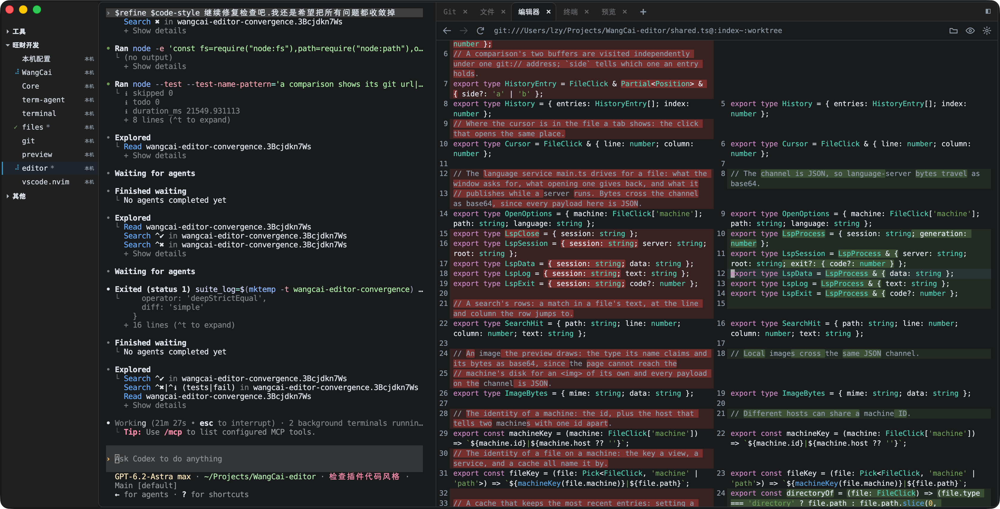

<p align="center"></p>

# 旺财 WangCai

旺财是一个面向本地与 SSH 远程机器的 macOS 桌面终端工作台：工作区、持久终端和文件视图
在同一个窗口里，窗口提供布局与插件管理，具体功能由插件实现。

业务逻辑在 [WangCai-Core](https://github.com/lengmoXXL/WangCai-Core) 里；壳与 Core 的职责划分、Core 的
来源见 [App 架构与通信](docs/architecture.md#壳与-core)。

<p align="center"><a href="#用键盘审查-codex-的改动"></a></p>

## 为什么写旺财

- 期望编码 agent（如 Claude Code）跑在远端机器上，笔记本开发更友好（因此用远端后台进程，而不是把远程工作区当成 SSH 会话）
- 复用 Node.js 生态，显示效果比终端渲染更好
- 期望把 Neovim 的扩展能力带到开发工作台应用里

## 交互演示

### 用键盘审查 Codex 的改动

https://github.com/user-attachments/assets/5468408d-af88-4fd7-a990-9cb33ba7e869

在 `editor` 工作区，左侧的 Codex 正在运行 `refine`。按 `Ctrl+Space`、`g`、`g` 在右侧打开 Git，用 `j`、`k` 选文件，按 `Enter` 查看补丁。在新增行再按一次 `Enter`，编辑器就会并排显示修改前后的代码。

录像里，`gf` 打开工作区文件，`gd` 跳到 `LspProcess` 的定义，`gr` 列出项目里的引用。从引用列表按 `Enter`，可以看到编辑器插件启动语言服务时递增 `generation` 的那行代码。[MP4 原文件（57 秒，含同步按键）](docs/assets/editor-refine/keyboard-review.mp4)

[快捷键提示](docs/assets/editor-refine/shortcuts.png) · [Git 中的新增依赖](docs/assets/editor-refine/git.png) · [双栏差异](docs/assets/editor-refine/comparison.png) · [LSP 引用](docs/assets/editor-refine/references.png)

### 工作区、文件与预览

[](docs/assets/demo.webm)

演示里右侧的文件、编辑器与预览视图来自官方插件，在 [配置](#配置) 的 `tabs` 里列出后出现。[查看 Markdown 预览截图](docs/assets/screenshot.png)

## 安装

1. 从 [Releases](https://github.com/lengmoXXL/WangCai/releases) 下载 macOS 包：
   Intel 选 `x64`，Apple Silicon 选 `arm64`。
2. 当前包是 ad-hoc 签名；若 macOS 阻止打开，确认来源后在
   “系统设置 → 隐私与安全性”中允许打开。
3. 首次启动会先 clone 并构建业务内核 Core（需要系统 `git` 与网络，见
   [壳与 Core](docs/architecture.md#壳与-core)），再安装官方工作区、文件和终端插件；App 自带构建它们
   所需的 Node 与 npm。本机与远端用的 `wangcai` 节点由 Core 从 release 下载，App 不带它。之后的启动
   用已经装好的那份，不再联网。

## 配置

入口是 `~/.config/wangcai/init.ts`，数据目录是 `~/.local/share/wangcai`。

首次启动只在入口不存在时生成它，改完重启 App 生效。

入口用 `export default` 导出配置对象，无需构建：

```ts
export default {
  font: { family: 'Menlo, monospace', size: 13 },
  theme: {
    WangCai: { background: '#121314', accent: '#3994bc' },
    Midnight: { background: '#0d1117', surface: '#161b22', border: '#30363d' },
  },
  workspaces: [
    {
      id: 'terminal-agent',
      config: {
        machines: [
          { host: 'local', env: { PATH: '$HOME/.local/bin:$PATH', GOPATH: '$HOME/go' } },
          { name: '开发机', host: 'dev-box', env: { PATH: '$HOME/.local/bin:$PATH' } },
          { name: '测试机', host: 'test-box' },
        ],
      },
    },
  ],
  tabs: [
    { id: 'files' },
    { id: 'terminal', config: { font: { size: 15 } } },
  ],
};
```

顶层有 `theme`、`font`、`network`、`workspaces`、`tabs`、`leader`、`timeout`、`keys`、`commands`。省略 `network` 表示直连，省略 `workspaces` 与 `tabs` 表示列表为空。键位那四项（`leader`、`timeout`、`keys`、`commands`）的写法见 [Core README 的「快捷键」](https://github.com/lengmoXXL/WangCai-Core#快捷键)。

`font` 为窗口和插件声明的字体字段提供默认值。`family` 是 CSS 字体列表，`size` 用像素，`lineHeight` 是字号的倍数。插件的 `config.font` 逐项覆盖全局值，两处都省略的字段使用插件默认值。

### 插件配置

工作区条目提供工作区列表与创建菜单，标签页条目提供侧栏视图，两者条目格式相同：

| 条目参数 | 说明 |
| --- | --- |
| `id` | 必填；插件标识，默认也用作插件目录名 |
| `repo` | Git 仓库 URL；不写 `repo`、也没有 `directory` 时用官方 `WangCai-<id>` 仓库；`https://github.com/` 开头的链接按「出网（network）」出去 |
| `commit` | 交给 Git checkout 的提交或引用，推荐完整 commit SHA |
| `directory` | 插件目录；相对路径从 init.ts 所在目录解析 |
| `config` | 插件自己的配置 |

- 只填 `directory`：加载该目录的现成产物，不装依赖也不构建。
- 同时填 `repo`、`directory`：把仓库安装到指定目录。
- 默认安装到 `~/.local/share/wangcai/plugins/<id>`。
- 未固定 `commit` 时，启动复用已有构建，点击插件更新才拉取默认分支；
  固定 `commit` 时按指定引用 checkout，写分支名并不表示始终跟随远端。
- 同一 `id` 重复出现时先出现的生效（先读 `workspaces` 再读 `tabs`）；
  已安装的 `id` 不能换成另一个仓库。

### 主题参数

`theme` 按名字给出主题，值是配色 patch，颜色写 `'#rrggbb'`：`background`、`foreground`、
`cursor`、`selection`、`surface`、`overlay`、`border`、`muted`、`accent`，
以及 `black` 到 `brightWhite` 的 ANSI 调色板。

内置 `WangCai`（深色）与 `GitHub`（浅色，取自 GitHub 自己的 Primer 色板）。
写内置的名字就是改它，写新名字就是加一个主题。没写到的 token 保留基底的值，
而新主题以 `WangCai` 为基底，所以浅色的自定义主题要把每个 token 都写上。

`<leader>ut` 列出所有主题供切换，选中的那个记在 `data/core/theme.json`，下次启动仍是它。
切换当场生效：终端、编辑器、预览与浮层都跟着换色，跑着的程序不受影响。

### 出网（network）

```ts
network: {
  proxy: 'socks5://127.0.0.1:7890',
  mirror: 'https://ghfast.top/',
},
```

壳安装或重建 Core 前可以先读 `network`。正常启动时 Core 加载配置，壳的 git 和 npm 从环境变量拿到代理，Core 下载 agent 时把同一份代理交给 curl。
`proxy` 写 `http://`、`https://` 或 `socks5://`。省略 scheme 时使用 `http://`，写 `socks://` 时使用 `socks5://`。socks5 走远端域名解析。

`mirror` 是 GitHub 加速前缀：`https://github.com/` 开头的链接都拼在它后面取，其它 URL（含
`git@github.com:` 形式的仓库）照原样用。

### 官方插件配置

[terminal-agent](https://github.com/lengmoXXL/WangCai-terminal-agent)、
[terminal](https://github.com/lengmoXXL/WangCai-terminal)、
[files](https://github.com/lengmoXXL/WangCai-files)、
[git](https://github.com/lengmoXXL/WangCai-git) 支持 `config.font`。terminal-agent 还有 `machines` 与 `images.maxCount`，具体字段见各自仓库的 schema。

`env` 是节点启动时带上的环境，节点的子进程（终端、agent、语言服务）都继承；
值里的 `$NAME` 在那台机器上展开，名字只能是 shell 标识符。

本机无需声明，创建菜单里始终有“本机”；要改它的名字或加环境变量，就写
`{ name: '本机', host: 'local', env: { … } }`（`name` 可省）。

### 连接 SSH 机器

先确认免交互认证与主机指纹已经配好，App 不弹出 SSH 密码输入框：

```sh
ssh -o BatchMode=yes dev-box 'uname -s -m'
```

远端需要可用的 SSH 服务和可写的安装目录，支持 macOS `x86_64 / arm64` 与 Linux `x86_64`。
下载在 App 所在机器完成，远端不需要 Node、npm、curl，也不需要访问 GitHub。

在 `terminal-agent.config.machines` 里加 `{ name, host, env }`；`host` 交给系统 `ssh`，可以用
`~/.ssh/config` 别名。

首次连接会按平台安装或更新远端 `~/.local/bin/wangcai`；本机那份装在本机数据目录的
`bin/wangcai` 下，同样由 Core 按版本下载。

## 开发文档

- [插件开发手册与 Tutorial](docs/plugins.md)
- [App 架构与通信](docs/architecture.md)
- [发布流程](docs/release.md)
- [SDK 接口参考](sdk/README.md)
